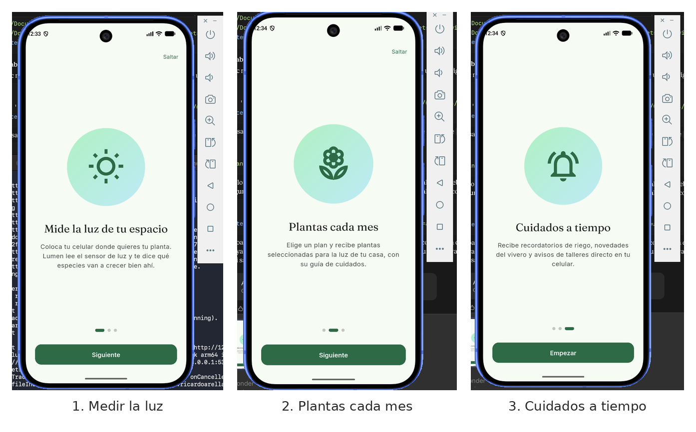
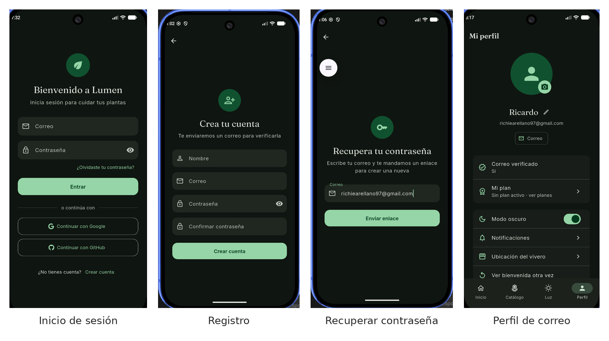
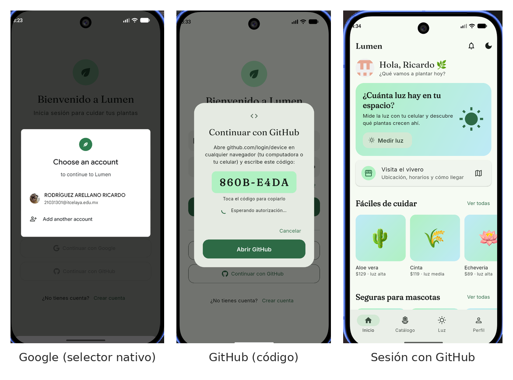
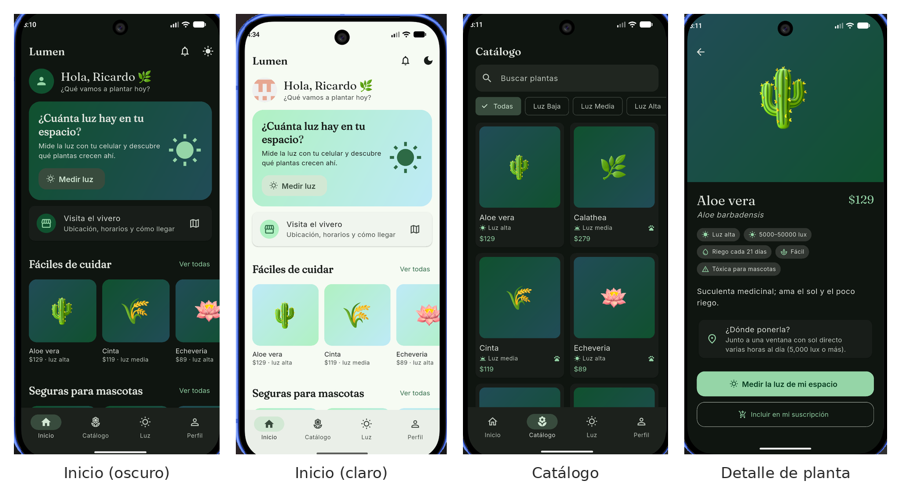
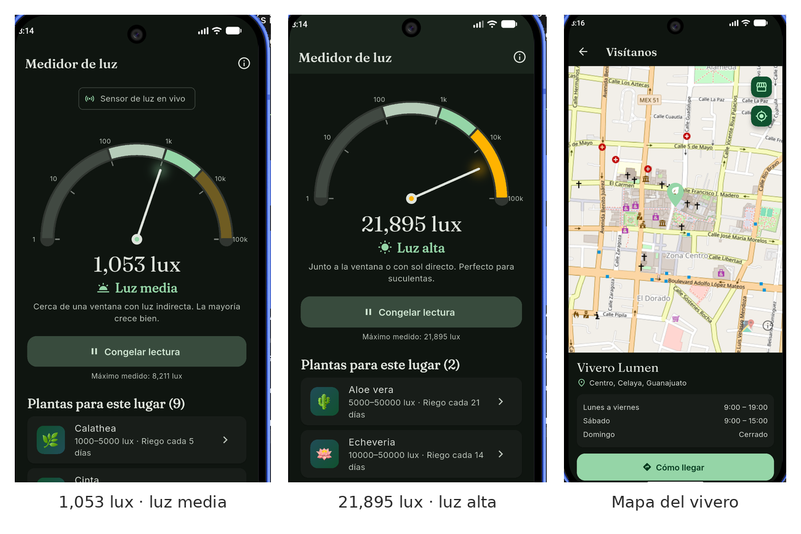
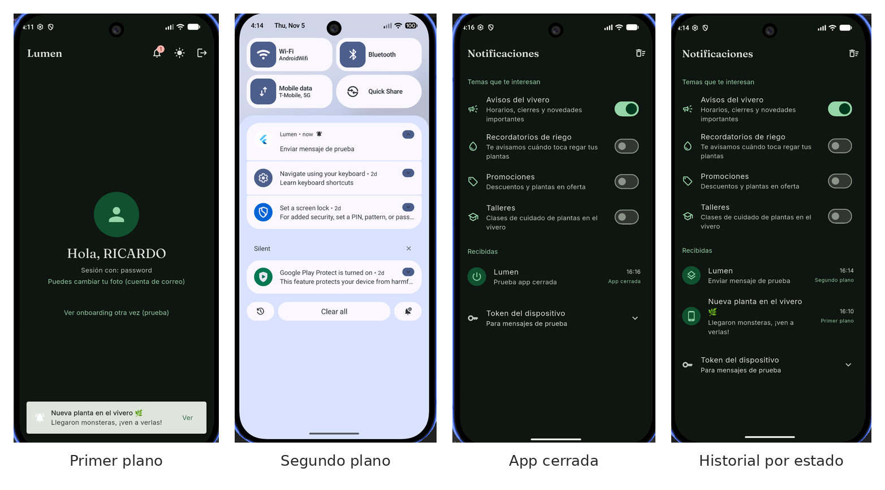
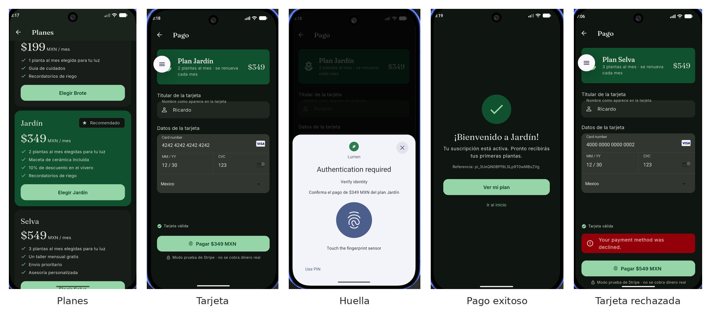
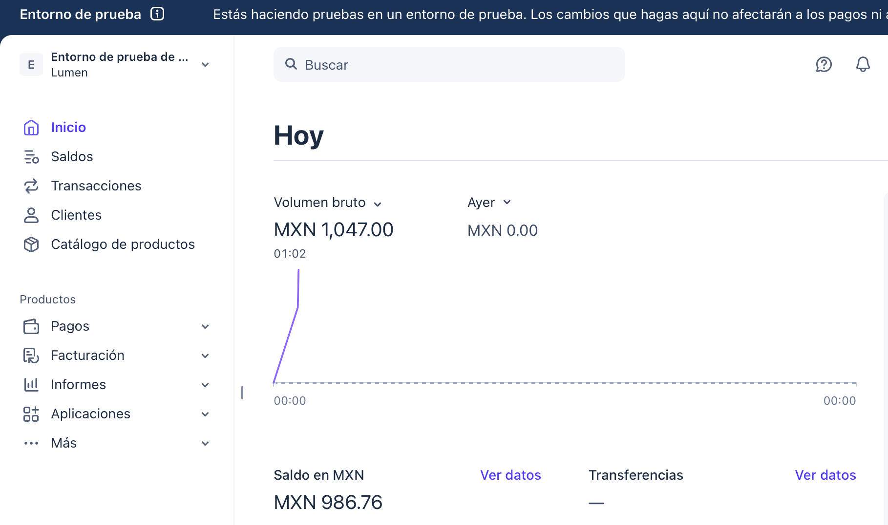
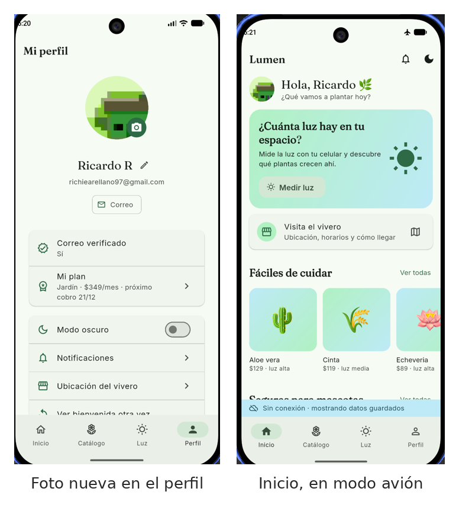
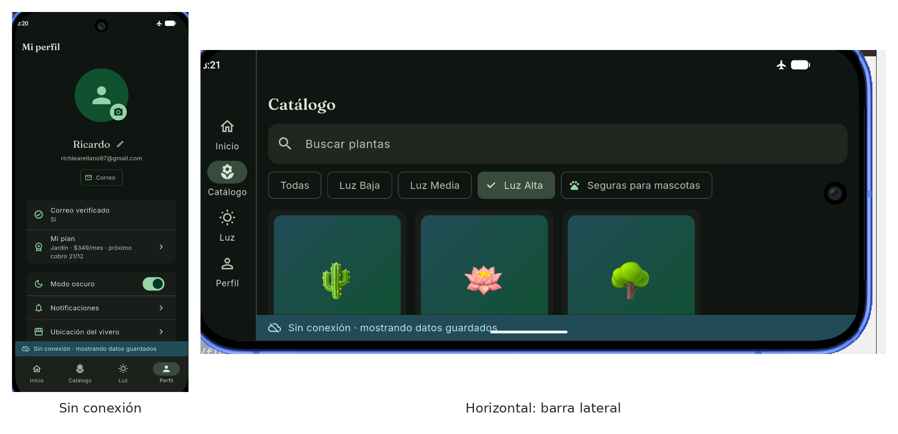

# Lumen 🌿

Aplicación móvil en Flutter para un vivero: mide la luz de cada rincón de la casa con el **sensor de luz ambiental** del celular, recomienda las plantas que crecen bien ahí y las ofrece por **suscripción mensual** con pago en línea.

Proyecto final (Práctica 3) de Desarrollo de Aplicaciones Móviles · Instituto Tecnológico de Celaya.
Autor: **Ricardo Rodríguez Arellano** (21031301) · Profesor: Ruben Torres Frias.

---

## Funcionalidades

| Módulo | Qué hace |
| --- | --- |
| **Autenticación** | Correo y contraseña con verificación obligatoria, reenvío del correo y recuperación de contraseña. Google con el selector nativo de cuentas de Android y GitHub con Device Flow (código en github.com/login/device). |
| **Perfil** | Datos del usuario y avatar del proveedor, sincronizado en el inicio y en el perfil. Solo las cuentas de correo pueden cambiar su foto. |
| **Catálogo** | 12 plantas y 3 planes en tiempo real desde Cloud Firestore, con búsqueda y filtros por luz y mascotas. |
| **Medidor de luz** | Sensor de luz ambiental leído en Kotlin (`EventChannel`), medidor dibujado con `CustomPainter` en escala logarítmica y plantas recomendadas según los lux. |
| **Notificaciones push** | FCM desde la consola de Firebase: listener global, 4 temas (topics) y recepción en primer plano, segundo plano y app cerrada. Historial guardado en Firestore. |
| **Mapa** | Ubicación del vivero en un mapa nativo (`flutter_map` + OpenStreetMap, sin WebView), distancia al usuario y "Cómo llegar". |
| **Suscripciones** | Planes Brote, Jardín y Selva; formulario nativo de tarjeta de Stripe; confirmación con huella; cobro en modo prueba de Stripe. |
| **Interfaz** | Material 3, fuentes Fraunces e Inter, tema claro y oscuro, onboarding, diseño responsivo (barra inferior o lateral según el ancho) y caché de imágenes sin conexión. |

## Capturas

### Onboarding


### Inicio de sesión




### Inicio, catálogo y detalle


### Medidor de luz y mapa del vivero


### Notificaciones en los tres estados


### Suscripción con Stripe y huella




### Foto de perfil, sin conexión y diseño responsivo




## Tecnologías

- **Flutter 3.47 / Dart 3.13** · Android (emulador Pixel, API 37)
- **Estado:** Provider (`ChangeNotifier`), sin `setState` ni `ValueNotifier`
- **Navegación:** go_router con `StatefulShellRoute`
- **Firebase:** Authentication, Cloud Firestore, Cloud Messaging, Storage
- **Pagos:** Stripe (`flutter_stripe`) en modo prueba
- **Hardware:** sensor de luz (Kotlin nativo), `local_auth` (huella), `geolocator`
- **Otros:** `google_sign_in`, `flutter_map`, `cached_network_image`, `connectivity_plus`, `google_fonts`

## Arquitectura

```
Pantallas (features/)  →  Providers (estado global)  →  Servicios (services/)  →  Firebase · Stripe · Android
```

Solo los servicios hablan con Firebase, Stripe y el hardware; las pantallas leen el estado de los providers.

```
lib/
  main.dart            arranque: Firebase, Stripe, providers y router
  app.dart             MaterialApp, temas y scroll
  core/                router, tema, validaciones
  models/              Plant, Plan
  data/                catálogo de ejemplo
  services/            auth, firestore, storage, notificaciones,
                       sensor de luz, biometría, pagos
  providers/           sesión, tema, catálogo, notificaciones,
                       suscripción, conexión, avatar
  features/            auth, onboarding, home, catalog, light,
                       store, plans, notifications, profile, shell
  widgets/             avatar, aviso sin conexión
android/.../MainActivity.kt   canal nativo del sensor de luz
firestore.rules · storage.rules
```

## Cómo ejecutarlo

### Requisitos
- Flutter 3.47 o superior
- Android Studio con un emulador que tenga **Google Play** (necesario para FCM)
- Proyecto de Firebase configurado (`flutterfire configure`)

### Pasos
```bash
git clone https://github.com/ricardo-rodriguezdesk/Proyecto-Moviles-en-la-nube.git
cd Proyecto-Moviles-en-la-nube
flutter pub get
```

Crea las llaves de Stripe **de prueba** (no se suben al repositorio):
```bash
cp stripe.example.json stripe.json
# Edita stripe.json con tus llaves pk_test_... y sk_test_...
```

Enciende el emulador y ejecuta:
```bash
flutter emulators --launch Pixel_10
flutter run --release --dart-define-from-file=stripe.json
```

### Para probar en el emulador
- **Luz:** ⋯ → Virtual sensors → Additional sensors → Light (lux).
- **Huella:** configura un PIN y una huella en Ajustes; luego ⋯ → Fingerprint → Touch Sensor.
- **Ubicación:** ⋯ → Location → buscar "Celaya" → Set location.
- **Pago:** tarjeta `4242 4242 4242 4242`, fecha futura y cualquier CVC. Para probar un rechazo usa `4000 0000 0000 0002`.
- **Notificaciones:** Firebase → Messaging → mensaje de prueba con el token que muestra la pantalla Notificaciones, o una campaña al tema `avisos`.

## Seguridad

- Reglas de Firestore: el catálogo es de solo lectura; cada usuario solo accede a su perfil, sus notificaciones y sus pagos.
- Reglas de Storage: solo el dueño sube su foto, solo imágenes, de máximo 5 MB.
- Las llaves de Stripe van en `stripe.json`, excluido con `.gitignore`.

## Limitaciones

- **Firebase Storage** está implementado (código y reglas), pero no se activó: exige el plan Blaze y Google rechazó los métodos de pago. Mientras tanto, la foto de perfil se guarda comprimida en Firestore y el cambio de foto funciona completo.
- **Stripe:** el `PaymentIntent` se crea desde la app con una llave de **prueba**, como simplificación académica. En producción lo haría un servidor (por ejemplo, una Cloud Function).
- **Solo Android:** en iPhone, las notificaciones push requieren una cuenta de Apple Developer de pago y no hay acceso al sensor de luz (la app cambia a modo manual).

## Documentación

El reporte técnico completo está en [`Lumen_Reporte_Tecnico.pdf`](Lumen_Reporte_Tecnico.pdf).
